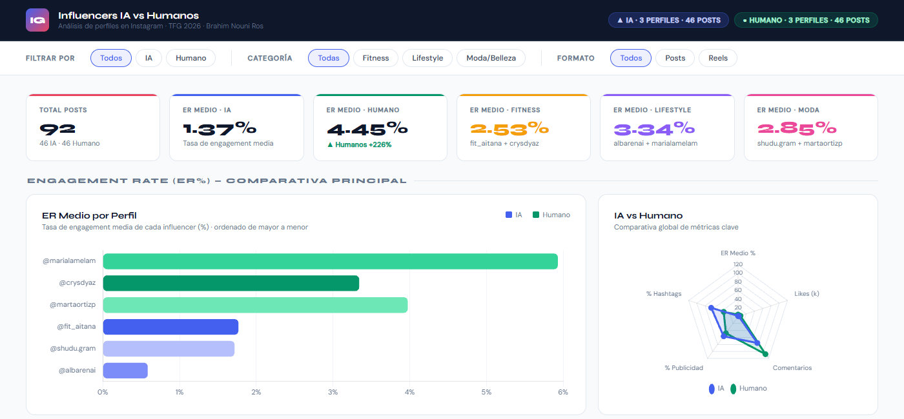

# Influencers IA frente a influencers humanos en Instagram

Trabajo Fin de Grado · Grado en Gestión de Información y Contenidos Digitales · Universidad de Murcia (2026)

**¿Pueden competir los influencers creados con inteligencia artificial con los influencers humanos?** Este estudio compara el engagement, la estrategia de contenido y la transparencia publicitaria de seis perfiles de Instagram: tres virtuales y tres humanos.

**[Ver el dashboard interactivo](https://brahimnr2003-beep.github.io/Tfg_influencers/)** · **[Leer la memoria (PDF)](docs/TFG_Brahim_Nouni_Ros.pdf)** · **[Datos](data/)**



---

## Resultados principales

| | Perfiles IA | Perfiles humanos |
|---|---|---|
| Engagement rate medio | **1,37 %** | **4,45 %** (+226 %) |
| Publicaciones con contenido de marca | 56,5 % | 47,8 % |
| Publicidad correctamente declarada | 15,4 % | 40,9 % |

1. **Los humanos generan bastante más engagement**, y la ventaja se mantiene en los tres sectores: Fitness, Lifestyle/Entretenimiento y Moda/Belleza.
2. **La distancia varía según el sector.** Es máxima en Lifestyle/Entretenimiento (+5,34 puntos), donde la conexión personal pesa más, y mínima en Moda (+2,25 puntos), donde manda la estética.
3. **Los perfiles IA declaran mucho menos su publicidad.** Dos de los tres no etiquetan ninguna colaboración. La excepción es @shudu.gram, que declara el 100 %.
4. **Los reels generan más engagement que los posts** en ambos grupos.
5. **La audiencia también crece más en los perfiles humanos.** @marialamelam gana 24.600 seguidores (+38 %) y @fit_aitana es el único perfil que pierde seguidores.

## Metodología

Estudio descriptivo-comparativo mediante **análisis de contenido cuantitativo**.

**Muestra.** Tres parejas de perfiles con la misma temática y una audiencia lo más parecida posible, de modo que las diferencias se deban al tipo de perfil y no al tamaño de la audiencia:

| Sector | Perfil IA | Perfil humano |
|---|---|---|
| Fitness | @fit_aitana | @crysdyaz |
| Lifestyle / Entretenimiento | @albarenai | @marialamelam |
| Moda / Belleza | @shudu.gram | @martaortizp |

**Periodo y volumen.** 92 publicaciones (46 por grupo, 15 o 16 por perfil) publicadas entre el 1 de enero y el 21 de abril de 2026, recogidas manualmente desde Instagram.

**Matriz de indicadores.** Cada perfil se registra al inicio y al final del periodo (seguidores y publicaciones). Cada publicación se codifica con:
- Interacción: likes, comentarios, visualizaciones, republicaciones y compartidos.
- Tema (9 categorías), formato (post o reel) y uso de hashtags.
- Publicidad (presencia de marca) y publicidad declarada (#ad, "colaboración pagada"…), según el Código de Conducta de IAB Spain / Autocontrol.

**Engagement rate (ER).** Normaliza la interacción para comparar perfiles con audiencias distintas:

```
ER post (%) = (likes + comentarios + republicaciones + compartidos) / seguidores × 100
ER reel (%) = (likes + comentarios + republicaciones + compartidos) / visualizaciones × 100
```

## Dashboard

El [dashboard](https://brahimnr2003-beep.github.io/Tfg_influencers/) es un único fichero HTML que funciona sin servidor ni base de datos. Permite filtrar por tipo de perfil, sector y formato, e incluye:
- El engagement por perfil, formato y tema.
- La transparencia publicitaria y el crecimiento de seguidores.
- Una tabla resumen con las métricas de cada perfil.

## Contenido del repositorio

```
Tfg_influencers/
├── index.html                              ← dashboard (publicado en GitHub Pages)
├── docs/
│   └── TFG_Brahim_Nouni_Ros.pdf            ← memoria completa
├── data/
│   ├── matriz_indicadores_influencers.xlsx ← hoja de cálculo original
│   ├── perfiles.csv                        ← 6 perfiles: seguidores y publicaciones al inicio y al final
│   └── publicaciones.csv                   ← 92 publicaciones con todos los indicadores
└── versiones/                              ← versiones anteriores del dashboard
```

La hoja de cálculo incluye también el **libro de códigos** (pestaña CÓDIGOS) y un **resumen estadístico** que se calcula con fórmulas (pestaña RESUMEN). Los CSV son una exportación de las pestañas PERFILES y PUBLICACIONES para consultarlas sin Excel. Los códigos numéricos de sus columnas se explican en el libro de códigos.

## Limitaciones

- La muestra es pequeña (6 perfiles) y se eligió de forma intencionada, así que los resultados describen estos perfiles y no se pueden generalizar a todos los influencers.
- Las métricas son las visibles públicamente en el momento de la recogida.
- El periodo coincide con la edición 2026 de *Supervivientes*, lo que favorece el crecimiento de los perfiles ligados al programa.

---

**Brahim Nouni Ros** · Tutora: Manuela López Pérez · Universidad de Murcia, convocatoria de mayo de 2026
[LinkedIn](https://www.linkedin.com/in/brahim-nouni-ros-data-ia) · [GitHub](https://github.com/brahimnr2003-beep)
